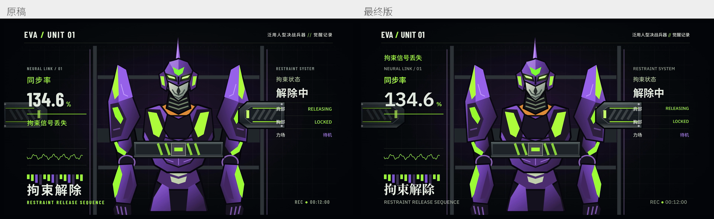

# Typography: improvements and evaluation

This change makes font choice actionable: **40 inspectable families, role and brand guidance, actual-copy comparisons, verified on-demand acquisition, and versioned font/license import**. It replaces an underspecified choice with a reviewable path from the brief to the rendered words. A fixed-scene EVA study demonstrates a useful local outcome: two independent blinded model reviewers found less repetitive technical typography and clearer text roles in the final treatment, while all original wording, artwork, animation and audio were preserved.

[Watch the synchronized 24-second comparison](../../examples/typography-eva/synchronized-comparison.mp4) · [Case, source delta and evidence](../../examples/typography-eva/README.md) · [Catalog and usage](../fonts.md)

## The problem and the implemented response

The observed failure was repeated use of one generic technical voice across identity, readings, explanations and narrative events. Small condensed uppercase labels, expanded tracking and bright bilingual subtitles could remain prominent even when they contributed little to the immediate event. Changing to an unfamiliar face alone did not resolve those relationships. The supplied screenshot could not establish its original font or a fallback failure.

| Needed behavior | Implemented response | Why it helps |
| --- | --- | --- |
| Keep the actual identity | Distinguish original marks, prescribed brand text and open creative roles | A catalog suggestion cannot silently replace a wordmark or turn a showreel into a brand advertisement |
| Choose a face for a reason | Compare different constructions using the actual words at equal size, weight, width and spacing | The decision can cite a visible difference instead of a genre label or novelty |
| Keep text readable in its destination | Review required copy, regional glyphs, hierarchy and reading windows at the intended display width | A large source canvas and successful font load do not establish phone readability |
| Make selected fonts available | Immutable upstream URLs, byte/SHA checks, verified cache and normal versioned import with licenses | The editable project carries its selected resources rather than relying on a machine's system fonts |
| Cover distinct voices and scripts | Expand the original 20 to 40 without replacing their resources or metadata | Rounded, slab, stencil, comic, script, pixel and language-specific gaps get deliberate alternatives |

The shared guide is reached from creation, template adaptation, recreation and review. Existing typography is retained for unchanged preview/export and unrelated edits. The catalog is advisory; there is no universal four-font recipe, mandatory second family or ban on familiar faces.

## What the fixed-scene case shows

The original project and prompt behind the screenshot were unavailable. With permission to use a similar prompt, a new 24-second, 1920×1080, 30 fps case was authored on 2026-11-13. Its sequence is restraint/synchronization monitoring → head raise and illuminated eyes → restraint release → A.T. Field expansion → UNIT 01 ending. This is a newly authored analogue, not a reproduction of the screenshot's project.

One native fixture was frozen. Old/new Skill edits used isolated copies of that fixture. Additional family-only and treatment/copy controls separated possible contributions. A later ordinary completion pair removed the explicit complaint cue. The final combination incorporated the observed tradeoffs while retaining every original phrase.

| Comparison | Observed result | Implication |
| --- | --- | --- |
| Final treatment vs frozen original | Both blinded reviewers saw a meaningful, limited reduction in repeated technical treatment and clearer event/instrument/identity roles | Supports a visible local benefit from the combined choices |
| Font-family-only control | Both reviewers saw useful but limited separation of event and instrument voices | Face construction contributes; its value is not explained entirely by deleting text |
| Treatment/copy control | Some quieter repetition and readable Chinese events, without a clear gain in film-specific character | Unification and deletion alone are insufficient evidence of better font fit |
| Explicit complaint: old vs new Skill | Both produced useful repairs; no substantive new-Skill advantage | The complaint itself supplied a strong diagnostic cue |
| Ordinary task: old vs new Skill | Both had local gains and tradeoffs; enlarged events could overlap the machine and thin readings could lose emphasis | A single routine pair does not establish stable autonomous improvement |

The final treatment keeps Barlow Condensed 700 for UNIT 01/A.T. FIELD, Noto Serif SC 800 for Chinese events and the ending, IBM Plex Sans 500/600 for English labels/readings, and Noto Sans SC 500/700 for Chinese monitoring. IBM Plex Sans was already in the original 20-family catalog. These are role-specific choices for this case, not an official type identity or an exact substitute for proprietary lettering.

English explanations and final status remain present. Main identity/event/Chinese ending sizes are retained; supporting weight, tracking, color and numeric details are tuned, and the warning moves clear of a restraint. The final composition is byte-identical outside its style block. The benefits are therefore more specific than a claim that fewer words or larger titles look better.

## Review method and counterevidence

Two independent model reviewers received anonymous images, the same brief and separate axes: content fit, generic-template feel and readability. They did not see condition mappings, source, run logs or one another's opinions before submitting their reports. Reviewer 1 inspected five full 960×540 frames at 2/7/12/17/22 seconds plus contacts; reviewer 2 inspected 2/12/17/22-second full frames, with 7 seconds available in contacts. These are model judgments of still frames, not human ratings, statistical evidence, full-film audiovisual review or detection of AI authorship.

- Reviewer 1 placed the final synthesis among the weak preferred options: clearer text roles and quieter explanations, with the original context retained. Narrow system text was easier to distinguish, but some text still approached the machine silhouette.
- Reviewer 2 found the final synthesis the most direct evidence for reducing repeated font treatment without losing information. It did not win every axis: another option grouped right-side labels more clearly, while the final synthesis retained better immediate numeric grouping.
- Both retained counterevidence: familiar grids, green rules and large identifiers remain; a serif is not intrinsically EVA-specific; some event/body labels still overlap artwork; quieter English is less conspicuous. The final treatment is not a unique identity system or a demonstrated overall film-quality winner.

Anonymous conditions were A=new Skill/complaint, B=original, C=old Skill/complaint, D=family-only, E=treatment/copy-only, F=final synthesis, G=new Skill/ordinary task, H=old Skill/ordinary task. The ordinary pair and final synthesis were exploratory additions after the first results. F was Agent-curated after feedback, not a fresh autonomous generation.

Earlier whole-film trials used three contrasting briefs and then three holdouts. They helped expose phone-readability and brand-scope issues; fresh generations also changed materials, composition and sometimes aspect ratio. They do not isolate a font effect and are not counted as additional confirmations of reduced template feel. The fixed-scene case supplies the more useful comparison.

## Integrity and current implementation validation

The historical experiment used `gpt-6.1-sol` with high reasoning, Codex app-server 0.166.0 and the 20-family catalog on the source baseline recorded in the [evidence manifest](../../examples/typography-eva/evidence.json). All eight selected exports passed technical checks and retained matching decoded PCM audio. Source isolation, MP4 identities, editable ZIP CRCs and browser playback to the end were checked. Browser playback was muted; this does not claim listening or human acceptance.

The current PR expands availability to 40 families; the historical movies were not regenerated with all 40, and cannot prove an aesthetic effect from the additional 20. The added resources were independently downloaded through the preparer, verified against pinned bytes/licenses, parsed for actual metadata and representative script coverage, and viewed in six browser specimens including Arabic RTL and Hindi. Coverage samples and font loading do not establish every character, regional form or shaping behavior.

The catalog is about 143 KB of JSON; its compact projected index is about 12 KB. Preparing every upright file would fetch about 224 MB, but no complete font collection ships with the Skill. Agents read the index, inspect candidates, prepare only the selected weight, and import the returned local paths with licenses. A bold-only family's omitted weight now resolves to an available face instead of failing at an unavailable 400.

Deterministic checks cover resource discovery, hash/cache failure and repair, unavailable weights, offline specimen integrity and direction, real versioned font/license import, corrupt inputs, request/item deduplication, restoration and distribution. Current-head validation is recorded in the PR description separately from these historical creative observations.

## Supported conclusion

The PR delivers a concrete, maintainable selection-and-delivery workflow and a visible positive fixed-scene example. The strongest aesthetic evidence supports **purposeful font roles plus treatment, with original information preserved**. Stable new-Skill superiority across scenes remains an evaluation target; catalog size or a single converged result is not a substitute for that evidence.
